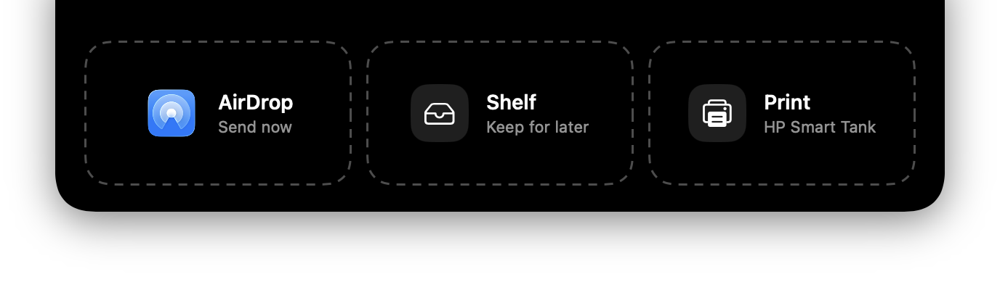
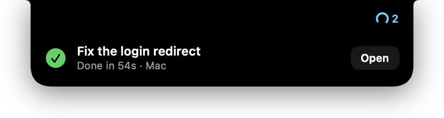

# NotchIsland

A small Dynamic Island for the MacBook notch. It hides in the notch, slides out notices when something finishes or needs you, and opens when you hover it. Drag a file onto it to AirDrop, park or print it.





## Install

```sh
curl -fsSL https://raw.githubusercontent.com/jmqcooper/notch-island/main/install.sh | bash
```

This puts the latest release in `~/Applications` and opens it. Hover the notch to start, and turn on **Open at Login** in the gear menu. Run the same line again to update.

You can also download `NotchIsland.zip` from [Releases](https://github.com/jmqcooper/notch-island/releases/latest) and move the app to Applications. The app is signed ad hoc and not notarized, so macOS blocks the first launch of a browser download: try to open it once, then click **Open Anyway** in System Settings → Privacy & Security. The install script skips that step because `curl` downloads aren't quarantined.

## What it does

- **At rest** it hides inside the notch. Wings appear when something is live: what's playing on the left (album art or a focus timer), what needs attention on the right (an agent waiting on you, a meeting in the next 10 minutes, agents working).
- **Notices** slide out under the notch with an action: an agent finished (Open), an agent needs you (Answer), PR checks failed or passed, a deploy failed or went live, a meeting is about to start (Join), a focus timer ended.
- **Hover** the notch to open it. Tabs sit in the menu bar band:
  - **Home**: music controls plus the three most urgent live rows.
  - **Agents**: [T3 Code](https://github.com/pingdotgg/t3code) threads on this Mac and on any SSH hosts you add, plus your open PRs and recent Railway deploys. Answer an agent's question or approval in place, or open the exact thread in T3.
  - **Shelf**: files you parked. Drag them back out, AirDrop them, or clear them.
  - **Mirror**: the camera, only while the tab is open.
- **Drag a file** toward the notch: drop it on AirDrop, on Shelf to keep it, or on Print to print it on the printer where the Mac is right now. The Print zone names the printer it found and is greyed out when there is none. A notice confirms the job, with Cancel.
- **Prints are black and white on both sides.** Hold ⌥ while dropping to print in colour on one side, for photos. A printer that can't print both sides by itself prints the fronts first; a notice then stays up saying to reload the pages blank side up, top edge first, with **Print backs**.
- The gear menu has **Open at Login** and **Quit**.

Every integration is optional. Without T3 Code, `gh` or `railway`, those rows stay empty and the rest works.

## Requirements

- macOS 14 or later. It's built for MacBooks with a notch; on other displays it draws a notch-sized island at the top centre of the main screen (untested).
- To build it yourself: Swift 6 (Xcode 16 or the Command Line Tools).
- Optional: Spotify or Music, [T3 Code](https://github.com/pingdotgg/t3code), the [GitHub CLI](https://cli.github.com) and the [Railway CLI](https://docs.railway.com/guides/cli), each already logged in.

## Build from source

```sh
./scripts/build.sh --install   # builds, copies to ~/Applications, relaunches
./scripts/build.sh --release   # universal, ad-hoc signed build/NotchIsland.zip
```

`--install` signs with your first "Apple Development" certificate, or ad hoc when there is none (or set `CODESIGN_IDENTITY`). With ad-hoc signing, macOS asks for the Automation permission again after every rebuild.

Pushing a `v*` tag builds the zip on GitHub Actions and publishes it as a release.

macOS asks once each for Calendar, Camera (first time you open Mirror) and permission to control Spotify or Music (first time you press play).

## Where the data comes from

| Feature | Source |
| --- | --- |
| Music | Spotify / Music playback notifications, AppleScript for controls |
| T3 status | A read-only poller over `~/.t3/userdata/statev2.sqlite`, run with the system `python3` locally and over SSH on each remote host |
| Answering agents | T3's WebSocket API with a token the app issues on first use (`t3 auth session issue`, label `NotchIsland`, 90 days), stored in the Keychain. Remote hosts are reached through the poller's SSH tunnel. |
| Meetings | EventKit, join links from the event URL, location or notes |
| PRs | `gh api graphql` (your open PRs and their check status) |
| Deploys | `railway api` (latest deploy per service) |
| Printing | CUPS network discovery (`lpstat -e`), so no printer setup is needed and it follows the Mac between places. PDFs, images and plain text go through `lp` with `print-color-mode=monochrome`, plus `sides=two-sided-long-edge` when the queue has a Duplex option. Otherwise PDFKit splits PDFs into fronts (odd pages) and backs (even pages, a blank back when the count is odd). Other documents open in their own app's print dialog, which asks once for Automation access to that app and uses that dialog's settings. |

There's no server or account of its own. Its network traffic is the SSH connections to hosts you list, the `gh` and `railway` CLIs, Spotify album art, and files you drop on AirDrop or Print.

## Settings

Watch T3 Code on other machines you can reach with `ssh <host>` (key-based, no password prompt):

```sh
defaults write com.jmqcooper.NotchIsland t3RemoteHosts -array my-server other-host
```

Revoke the T3 token with `~/.t3/bin/t3 auth session list` and `t3 auth session revoke <id>`.

## Debugging

Logs go to `~/Library/Logs/NotchIsland.log`. Scripts can drive the island through a distributed notification named `com.jmqcooper.NotchIsland.debug` with the object `open:home`, `open:agents`, `open:shelf`, `open:mirror`, `drop`, `drop:print`, `close`, `notice`, `notice-action` (presses the notice's button), `timer:<minutes>`, `print-held:<path>` or `print-held-colour:<path>`. `print-held` sends the file through the real print path but holds the job in CUPS, so tests use no paper; cancel it with `cancel <job-id>`.

```sh
osascript -l JavaScript -e "ObjC.import('Foundation'); \$.NSDistributedNotificationCenter.defaultCenter.postNotificationNameObjectUserInfoDeliverImmediately('com.jmqcooper.NotchIsland.debug', 'open:home', \$(), true)"
```

## License

[MIT](LICENSE)
